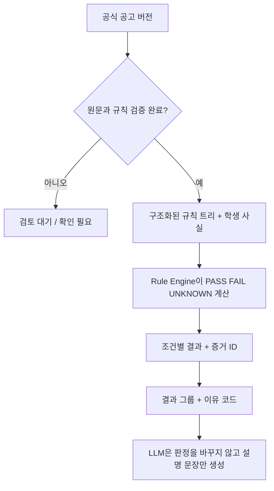

# 자격 판정 정책 — Rule Engine의 입력·계산·출력

> **유일 책임:** 확인된 공고 규칙과 학생 사실로 어떤 결과를 계산하는지. 여기서 정의하지 않은 기관별 실제 조건은 코드로 추정하지 않는다. 원천 규칙 `BR-B01~B09`는 `04-business-rules.md`에 있다.

## 1. 판정 조건

**자동 판정 가능 전제:** (1) 공식 원문 버전이 확인·검증됨, (2) 적용해야 할 필수조건이 누락되지 않았음, (3) 각 조건의 비교 연산자·기준 시점·AND/OR/예외가 구조화 가능함, (4) 학생 입력값의 의미·기준 시점이 해당 조건과 호환됨.

전제 조건이 충족되지 않으면 **확실한 `가능`을 반환해서는 안 된다.** 검토 대기·추출 실패·자료 불완전·지원하지 않는 논리연산은 판정의 `UNASSESSABLE` 사유로 기록하고 사용자에게는 `확인 필요`로 안내하는 것이 이 문서의 안전한 제안이다. 판정 값과 데이터 검증 상태는 서로 다른 필드로 분리한다.

## 2. 개별 결과

| 상태 | 정확한 의미 | 예시(가상) | 오해 방지 |
|---|---|---|---|
| `PASS` | 해당 조건을 확인된 사실로 충족 | 공식 공고: 2학년 이상; 입력: 3학년 | 실제 재학 증명까지 자동 검증한 것 아님 |
| `FAIL` | 해당 조건에 **확정적으로** 미충족 | 위 공고에서 학생이 1학년이라고 정확하게 입력 | 조건을 모른다고 FAIL 아님 |
| `UNKNOWN` | 사실이 없거나 조건 의미가 확정되지 않아 비교 불가 | 소득구간 모름, 휴학 예외 원문 모호 | `0`/불가/기본값과 다름 |

각 `ConditionEvaluation`에 `condition_id`, `result`, `reason_code`, `evidence_ref`, `student_fact_ref`, `notice_version_id`를 연결한다. `reason_code`는 `MISSING_FACT / INSTITUTION_CONFIRMATION / RULE_UNVERIFIED / UNSUPPORTED_OPERATOR / VALUE_MISMATCH / EVALUATED` 등으로 **초안 제안**이다.

## 3. 3값 논리 — 자격 판정용 진리표

### 필수조건 AND

| A | B | A AND B | 이유 |
|---|---|---|---|
| PASS | PASS | PASS | 둘 다 충족 |
| PASS | UNKNOWN | UNKNOWN | 한 조건 미확인 |
| PASS | FAIL | FAIL | 한 필수 조건 불충족 |
| UNKNOWN | UNKNOWN | UNKNOWN | 둘 다 미확인 |
| UNKNOWN | FAIL | FAIL | 한 필수 조건 불충족이 확정 |
| FAIL | FAIL | FAIL | 둘 다 불충족 |

### OR (원문이 대안 자격을 명시했을 때만)

| A | B | A OR B | 이유 |
|---|---|---|---|
| PASS | PASS | PASS | 하나 이상 충족 |
| PASS | UNKNOWN | PASS | 다른 조건의 미확인과 무관하게 한 조건 충족 |
| PASS | FAIL | PASS | 한 조건 충족 |
| UNKNOWN | UNKNOWN | UNKNOWN | 충족 여부 불명 |
| UNKNOWN | FAIL | UNKNOWN | 확정 충족 없음, 나머지 모름 |
| FAIL | FAIL | FAIL | 양쪽 불충족 |

**중요:** 원문에서 A AND (B OR C)면 그 트리를 그대로 평가해야 한다. A, B, C를 모두 AND로 바꾸면 거짓 불가 결과가 나온다. 우대사항·동점자 우선순위는 **필수 적격성**과 구분하며 합격 예측으로 변환하지 않는다.

## 4. 최종 판정 변환

| 전제 | Rule Engine aggregate | 사용자 표시 | 조치 |
|---|---|---|---|
| 검증된 완전한 규칙 집합 | PASS | `ELIGIBLE` 가능 | 조건 근거와 조건충족 한계를 표시 |
| 검증된 완전한 규칙 집합 | FAIL | `INELIGIBLE` 불가 | 실패한 필수조건·근거 제시 |
| 검증된 완전한 규칙 집합 | UNKNOWN | `NEEDS_REVIEW` 확인 필요 | 누락된 사실·질문/기관 확인 이유 제시 |
| 원문/추출 검증 보류·자료 불완전 | 판정 확정 불가 | `NEEDS_REVIEW`/검토 중 | **기존 상태를 검증 성공으로 위장 금지** |
| 갱신된 새 버전이 확인되었으나 미재판정 | 이전 판정은 `STALE` | 재확인 필요 | 이전 버전 근거와 현재 상태 구별 |

**빈 배열 금지:** 일반적인 프로그램의 `every([]) == true`라도 조건이 하나도 없는 공고를 근거 없이 PASS로 만들지 않는다. 해당 공고가 실제로 무조건 신청 가능이라는 공식 규정을 제공한 경우는 **공식 확인된 별도 규칙**으로 표현한다.

## 5. 처리 순서·결정의 소유권

**분리 이유:** LLM 추출 오류는 출처 검증 단계에서 제어하고, Rule Engine은 같은 입력에 같은 결과를 제공해야 회귀 테스트가 가능하다. AI 설명은 입력된 계산 결과를 소비할 뿐 재계산하지 않는다.

## 6. 구체적인 가상 예제

공고: `신청 가능한 대상은 2학년 이상 AND 소득구간 5 이하`라고 명시(실제 공고 아님).

1. 학생 X: 3학년·소득 4 → PASS/PASS → **가능**.
2. 학생 Y: 1학년·소득 모름 → FAIL/UNKNOWN → **불가**(학년 조건이 확정 미충족).
3. 학생 Z: 3학년·소득 모름 → PASS/UNKNOWN → **확인 필요**(소득 질문).
4. 학생 W: 3학년·소득 7 → PASS/FAIL → **불가**.
5. 원문이 `소득 5 이하 OR 특정 별도 자격`인데 별도 자격이 UNKNOWN → 소득 7이어도 전체 UNKNOWN(OR 규칙 구조를 보존한 경우).
6. 원문에 `재학생`만 쓰고 휴학생 포함 여부가 불명확 → 서비스가 임의로 `재학생=false` 처리하지 않음 → **기관 확인 필요**.

기계 점검용 테스트 데이터는 `../../examples/eligibility-cases.json`에서 관리한다. **실제 데이터는 반드시 해당 공고 원문으로 다시 정의**한다.

## 7. 입력·출력 불변식

- **입력:** verified `rule_set_id`, `notice_version_id`, 평가 기준 시각, 학생의 typed facts (값/단위/기준일/출처), 지원하는 AST/operator 종류.
- **출력:** per-condition evaluations, aggregate, 표시 가능 상태, causes, evidence IDs, student fact IDs, timestamp, version.
- **멱등성:** 같은 `rule_set` + 동일 학생 사실 스냅샷 + 평가 시각 기준 → 같은 구조화 결과(설명 문구 변경 가능).
- **금지:** DB 최신값을 도중에 섞어 같은 평가 중 입력이 변하는 것; LLM에게 `eligible = true` 쓰게 하기; UNKNOWN을 숫자 0으로 변환.
