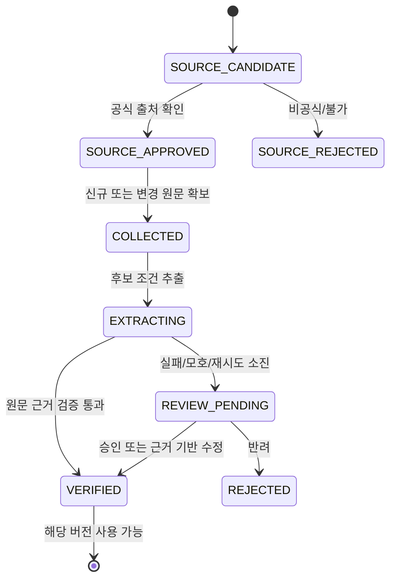
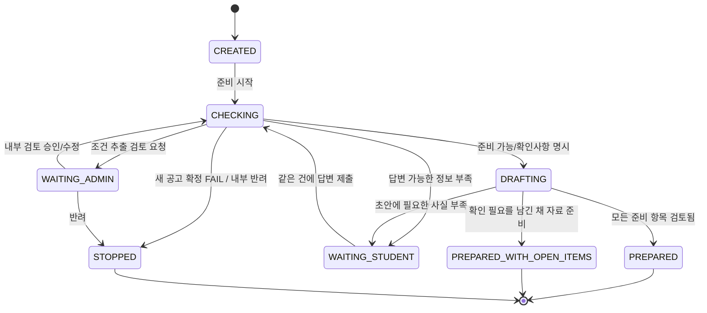

# 상태 모델 — 서로 다른 5가지 생명주기

> 책임: **상태와 전이**만 정의한다. 전체 자격 계산은 `05-eligibility-policy.md`에서; 구현 큐/체크포인트는 아키텍처에서 설명한다. 아래 코드명은 API/DB 초안을 위한 **제안**, 의미·전이 경계는 원본 A/B/C를 따른다.

## 1. 절대 하나의 `status`로 합치지 말 것

| 상태 축 | 소유 객체 | 예시 상태 | 어떤 질문에 답하나 |
|---|---|---|---|
| `source_verification` | `NoticeVersion` | CANDIDATE, EXTRACTING, REVIEW_PENDING, VERIFIED, REJECTED | 이 공고 조건을 신뢰할 수 있나? |
| `freshness_check` | `NoticeVersion`/LatestCheck | UNCHECKED, CHECKED_UNCHANGED, CHECKED_CHANGED, CHECK_FAILED | 새 원문으로 확인했나? |
| `eligibility` | `EligibilityAssessment` | ELIGIBLE, INELIGIBLE, NEEDS_REVIEW; 별도 `STALE` 플래그 | 이 학생이 이 버전의 자격 조건을 충족하나? |
| `preparation` | `PreparationCase` | CREATED, CHECKING, WAITING_STUDENT, WAITING_ADMIN, DRAFTING, PREPARED, PREPARED_WITH_OPEN_ITEMS, STOPPED | 신청 준비 업무는 어디까지 왔나? |
| `execution` | `Run/Job` | QUEUED, RUNNING, INTERRUPTED, SUCCEEDED, FAILED | 비동기 기술 작업이 지금 실행 중인가? |

`INELIGIBLE`은 `source_verification=VERIFIED`와 양립할 수 있고, `WAITING_STUDENT` 중에도 `eligibility=NEEDS_REVIEW`일 수 있다. 실행이 SUCCEEDED라도 학생의 신청이 공식 제출되었다는 뜻이 아니다.

## 2. 공고·분석 상태

- `SOURCE_APPROVED`는 사이트 신뢰도, `VERIFIED`는 **개별 공고 버전의 조건**에 관한 것이다.
- 신규/변경/변경없음은 **수집 회차 분류**다. 분석 상태와 섞지 않는다.
- 검증 이전 임베딩을 공개 추천 인덱스로 사용할 수 없다.
- `CHECK_FAILED`는 **변경 없음**과 다르다. 실패는 성공적 회차로 위장하지 않는다.
- 변경된 공고는 새 `NoticeVersion`을 기록한다. 이전 `VERIFIED` 버전은 감사용 이력으로 유지한다.

## 3. 자격 평가 상태

자격 그룹 `ELIGIBLE / INELIGIBLE / NEEDS_REVIEW`는 **평가 결과 값**이다. 공고가 바뀌면 평가 행의 `stale=true` 또는 `superseded_by=...`로 최신 여부를 분리한다. 이전 결과를 UPDATE해서 새로운 판정의 근거·버전을 덮어쓰지 않는다.

| 이벤트 | 기존 평가 | 결과 |
|---|---|---|
| 학생이 missing fact 입력 | NEEDS_REVIEW | 새 입력 스냅샷으로 **새 평가** |
| 공고 새 버전 검증 완료 | 모든 기존 평가 | 새 버전 기준 **재평가 필요**, 구버전은 이력 |
| 새 버전 추출 미검증 | 기존 ELIGIBLE | 최신 `가능` 안내 금지, `검토/재확인 필요` |
| 평가 중 학생 프로필 수정 | 진행 중 평가 | 입력 스냅샷 고정 후 결과 산출; 새 입력은 새 평가 |

## 4. 신청 준비 건 상태

**주의:** 위는 경로를 나타내는 **제안 상태기계**다. 서비스는 UNKNOWN이 남아도 준비 자료를 만들 수 있지만, 어떤 항목이 위험해서 중단해야 하는지는 장학금/업무 정책과 OPEN-16 검토가 필요하다.

- 질문에 답한 경우 `preparation_case_id`를 새로 만들지 않고 이어간다.
- `resume`는 검증된 질문 ID/실행 ID/사용자 권한과 연결되고 중복 클릭이 결과를 중복 생성하지 않아야 한다.
- `PREPARED`는 **서비스 내부 산출물** 준비. 외부 공식 `SUBMITTED`는 별도의 외부 사실이며 연동 없이 자동 추정하지 않는다.
- 수정 공고 등장 시 준비 건은 필요한 경우 다시 `CHECKING`으로 되돌리고 이전 초안에 `stale`을 표시한다. 구체 재개 정책은 OPEN-04.

## 5. 내부 검토 상태

`OPEN → ASSIGNED(제안) → APPROVED | CORRECTED | REJECTED`; 단, `APPROVED/CORRECTED`는 원문에 일치하는 추출을 승인하는 것이지 학생 자격의 기관 판정을 승인하는 것이 아니다. 모든 결정에 `review_id`, `notice_version_id`, `evidence_ref`, `reviewer_id`, `reason`, `decided_at`을 남긴다.

## 6. 알림함과 푸시 전송 분리

- 알림함 기록: CREATED / READ / SUPERSEDED 등(제안).
- 외부 푸시: PENDING / SENT_REQUEST / DELIVERY_UNKNOWN / FAILED 등(제안). FCM 호출 성공은 기기에서 실제로 봤다는 뜻이 아니다.
- 공고 신규/변경, 학생 가능, 알림 정책 승인 조건을 만족해야 발송 후보를 만든다.

## 7. 검증해야 할 반례

- 기존 `가능` 공고가 변경되었는데 평가가 계속 최신으로 보이는가?
- 답변 대기를 앱 화면 로컬 state에만 저장했다가 새로고침하면 사라지는가?
- Agent Server Worker 종료 후 회복되어도 준비 건 상태가 유실되는가?
- 미검증 공고가 검토 대기인데 임베딩/추천 결과로 노출되는가?
- '초안 다운' 버튼 누르면 공식 접수 완료로 잘못 표시하는가?
