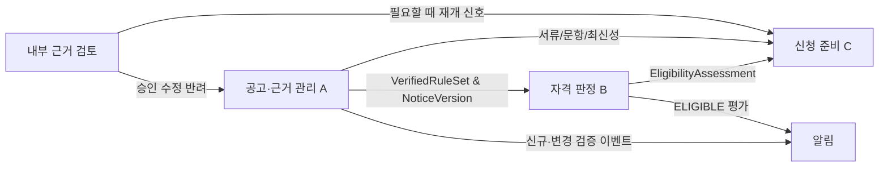

# 업무 객체와 경계 (DDD 전 단계의 개념 모델)

> 책임: **업무에서 보호해야 할 일관성과 객체 책임**. PostgreSQL의 물리 테이블 수/서비스 수를 확정하는 문서가 아니다. 사용자 수집 흐름 A/B/C는 한 시스템에서 구현할 수 있고, 바운디드 컨텍스트 = 마이크로서비스를 뜻하지 않는다.

## 컨텍스트 관계



## 주요 객체·책임·불변식

| 업무 객체 | 한 가지 책임 | 주요 값(개념) | 불변식/참조 |
|---|---|---|---|
| `OfficialSource` | 수집할 공식 출처가 무엇인지 기록 | 기관/URL/승인 상태/확인 시점 | 비공식 후보는 승인되지 않음 |
| `Notice` | 같은 모집 회차의 식별자 관리 | programId, institutionId, recruitmentKey | 동일 장학금 다른 모집 회차와 구별 |
| `NoticeVersion` | 특정 원문 스냅샷과 첨부·버전 이력 보존 | noticeId, contentHash, files, fetchedAt | 기존 버전 덮어쓰지 않음 |
| `EvidenceAnchor` | 추출된 조건을 원문의 정확한 위치로 연결 | noticeVersionId, fileId, span/page | 원문 없는 주장을 근거로 인정하지 않음 |
| `ConditionCandidate` | AI가 추출한 검증 전 조건 보유 | expression, source anchor, status | 판정기의 검증된 입력이 아님 |
| `VerifiedRuleSet` | 판정 가능한 조건 AST와 근거 묶음 | noticeVersionId, rootNode, validation | 비어있는 규칙 자동 가능 금지 |
| `StudentProfile` | 학생이 제공한 현재 사실 목록 보유 | ownerId, fields, observedAt | 다른 학생 접근 금지; 공식 증빙과 구별 |
| `StudentFactSnapshot` | 특정 평가에 사용한 입력 고정 | fields, units, effectiveAt, source | 평가 중 사용자 값 변조 금지 |
| `EligibilityAssessment` | 특정 공고 버전+사실 스냅샷의 판정 기록 | ruleSetId, factSnapshotId, group, details | 결과와 버전·근거가 항상 연결됨 |
| `PreparationCase` | 하나의 신청 준비 업무의 생명주기 소유 | studentId, noticeId, versionId, state | 답변 후에도 같은 case ID 유지 |
| `QuestionRequest` | 하나의 미확인 사실을 학생에게 묻기 | reason, expectedField, state, response | 본인·관련 case만 응답 가능 |
| `Checklist` | 필요한 서류·발급 경로 정리 | noticeVersionId, items, sources | 개인 증빙 파일 자체는 보관하지 않음 |
| `Draft` | 작성 문항별 학생 사실 기반 초안 | caseId, promptId, assertionRefs, version | 허위 사실 생성 금지; 사용자 검토 필요 |
| `VerificationReview` | 내부 검토 요청과 결정을 남김 | noticeVersionId, candidate, decision, reviewer | 기관 정책 승인 아님 |
| `NotificationRecord` | 학생별 신규/변경 공고 안내 기록 | studentId, noticeVersionId, event | 푸시 전송 성공과 별개의 개념 |

## 도메인 이벤트 후보(구현·이벤트 버스 필수 아님)

- `OfficialSourceApproved`, `NoticeVersionDiscovered`, `NoticeUnchanged`, `RuleExtractionNeedsReview`, `RuleSetVerified`, `RuleSetRejected`, `NoticeVersionSuperseded`, `AssessmentCreated`, `AssessmentMarkedStale`, `QuestionRequested`, `StudentAnswered`, `PreparationReady`, `PreparationStopped`, `NotificationEligible`.

**한 이벤트에 사업 판단 하나:** `NoticeVersionSuperseded`만으로 학생이 지원 불가가 되지는 않는다. 반드시 새 검증 규칙과 새 학생 판정을 거친다.

## 도메인 간 읽기/쓰기 방향

- A가 공고 원문/버전/근거/규칙을 소유. B는 A의 **검증된 규칙**을 읽어 판정하지만 직접 원문을 고쳐서는 안 됨.
- B가 판정 이력을 소유. C가 판정을 참조하고 최신 버전을 확인하지만 결과 필드를 임의로 바꾸면 안 됨.
- C가 질문·초안·준비 건을 소유. AI Worker/그래프가 동작해도 C의 영속 업무 기록을 Checkpoint 한 덩어리로 대체할 수 없음.
- 내부 검토는 추출 후보의 근거 정합성을 다루고 A에 검증된 변경을 요청. 사용자 개인 자료는 검토 화면에서 필요한 것만 노출.
- 알림은 A와 B의 **확정된 이벤트**를 소비. `가능` 판정을 직접 계산하지 않는다.

## 코딩 전 책임 배치의 예시(실제 구조 강제 아님)

```text
domain/
  notice/              # A: 출처·버전·근거, 검증된 규칙
  eligibility/         # B: 3값 AST 평가, 결과 생성
  preparation/         # C: 케이스·질문·초안 생성 계약
  review/              # 검토 결정
  notification/        # 가능+변경 안내 조건
application/           # 업무 흐름 오케스트레이션·트랜잭션
infrastructure/        # PostgreSQL, S3, Redis, LLM, FCM 등 어댑터
api/                   # 인증·DTO 변환·HTTP 계약
```

팀의 실제 레포 구조가 다르면 모듈 책임만 유지. 기존 구조의 이유를 조사한 뒤 변경하고 불필요한 ‘마이크로서비스화’를 하지 않는다.
