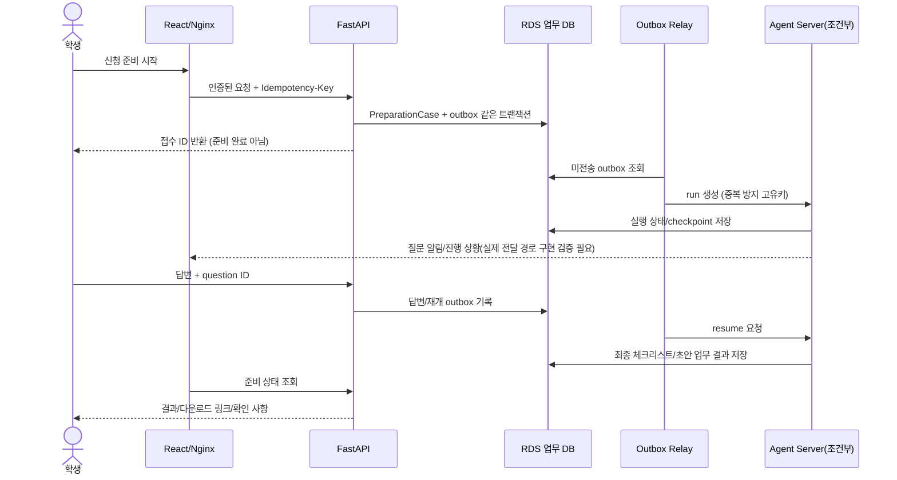

# v7 목표 아키텍처 해설 — 설계 사실 vs 실제 확인

> 책임: **어떤 컴포넌트와 데이터 흐름을 목표로 설계했는가**. 선택 이유/대안/대가의 단일 원본은 ADR; 업무 규칙은 도메인 BR. 이 문서는 **배포 완료 증빙이 아니다.**

## 1. 왜 시스템이 이렇게 복잡한가

프로젝트 팀은 제한된 기간·인력으로 개발하지만 **교수님의 대규모 사용자 가정을 고려**해야 했다(`EV-09`). 동시에 ① AI 작업이 오래 걸리고 ② 학생 답변·관리자 검토로 중단·재개되어야 하며 ③ 공고 정확성·버전·근거 추적이 필수다. 따라서 v7은 기능과 비동기 작업·안정성 책임을 분리한 **확장 목표**를 그린 것. **대규모 구현/성능 검증 완료를 뜻하지 않는다.**

## 2. v7 단일 EC2 배치 — 8개의 컨테이너

| 실행 요소 | 수 | 책임 | 주의 |
|---|---:|---|---|
| Nginx + React 웹 서버 | 1 | 브라우저 화면·HTTPS·`/api` 프록시 | 단일 EC2 장애에 함께 영향 |
| FastAPI | 1 | 사용자 인증/권한, 요청 입구, 업무 데이터+outbox 접수 | 긴 AI 작업 자체를 동기로 수행하지 않음 |
| Redis | 1 | 자체 `crawler_jobs` Stream, Agent Server 내부 실행 큐/스트리밍 의존성 | 업무 영속의 단일 원본 DB 아님 |
| Outbox Relay (Python) | 1 | DB outbox → Agent Server run 전달·전달 상태 갱신 | 중복 전달 가능 → 멱등성 필요 |
| Crawler (Playwright, 내장 scheduler) | 1 | 공고 수집·신규/변경 감지, 원문·메타 저장 | 확대 배치 시 scheduler 중복 등록 위험 |
| LangGraph Agent Server | 2 | 분석/질문/작성/알림 그래프, run/checkpoint, interrupt/resume | **조건부 전환 목표**. 현재 PoC 통과 확인 안 됨 |
| MCP Tool 서버 | 1 | 그래프에 공식 검색/조회/문서 파싱 도구 제공 | 학생 본인 자료만 조회, DB는 읽기 전용 |

8개의 컨테이너지만 **EC2 1대**이므로 서버 장애를 격리하는 HA가 아니다. Agent Server 2개는 *프로세스 수준* 장애 대응을 목표로 하며 실제 복구는 검증 필요.

## 3. EC2 외부의 관리형·외부 서비스

- **RDS PostgreSQL + pgvector:** 회원, 공고 버전/근거, 규칙, 평가, 준비, 검토, 알림 이력; Agent Server thread/run/checkpoint는 **별도 database**에 기록하는 목표. RDS 자체가 최종 운영 배포됐다는 증거는 없음.
- **S3:** 공식 원문 PDF/HWP/첨부 및 작성 초안 파일. DB에는 파일 위치·버전/메타 참조. 비공개·임시 presigned 다운로드.
- **FCM:** 기기에 푸시. 개별 알림함 기록과 구분. 목표 그림은 최대 500 토큰 묶음/요청, 실제 SDK·API 제한 및 방식은 사용하는 버전에서 재확인 필요.
- **외부 공식 기관/공공데이터, 검색 API, LLM API:** 공식 근거/추출·설명/임베딩. 공식성 검증과 비용/약관 필요.

## 4. 학생이 준비를 시작하면 (v7 기술 데이터 흐름)

핵심은 `응답(accepted)`과 `실제 작업 완료`를 구분하는 것. 작업 대기/재개는 DB 업무 기록과 그래프 체크포인트가 **각각 역할**을 가진다.

## 5. 공고를 가져오면

`Crawler 스케줄 → Redis crawler_jobs → 원문·첨부 S3 → NoticeVersion+outbox 같은 DB 트랜잭션 → Relay → Agent Server 조건 추출/근거 검증 → VerifiedRuleSet 저장·인덱싱 → 학생 프로필 평가 → 가능 학생에게 알림함/FCM`.

- `변경 없음`은 분석 생략. `접속 실패`는 변경 없음으로 취급하지 않음.
- 출처와 규칙 검증은 별개. 검증 실패 시 관리자 검토 대기(공개 불가).
- MCP 도구는 AI가 **그때 필요할 때** 조회; Crawler는 **주기적 수집**. 동일한 크롤러 기능을 MCP로 또 구현하지 않음.

## 6. 무중단/정확성은 별개

| 관심사 | v7의 설계 대응 | 아직 필요한 실제 확인 |
|---|---|---|
| 요청 지연 | FastAPI와 긴 AI 작업 분리 | 접수 p95, 대기·실행시간 각각 측정 |
| 작업 유실 | Outbox + 재정합성 검사, Agent Server checkpoint | DB commit 직후 종료, Relay 중복, Server 종료 시험 |
| 수집 작업 중복/장애 | Redis Stream `XACK/XAUTOCLAIM/DLQ` | 강제 종료·재처리·중복 원문 시험 |
| DB-파일 불일치 | S3 임시 업로드→DB 기록→검증 상태 전환, 고아 파일 정리 | 실패 주입 시험 |
| API·LLM 폭주 | 백프레셔·동시 수·요청 제한·타임아웃 | 실제 목표 RPS/동시수 미정 |
| 개인정보 | IAM, private bucket, 본인 인증, 읽기 전용 MCP, 로그 최소화 | IDOR/토큰/키 관리 검증 |
| 자격 정확성 | 검증된 공식 원문, Evidence, Rule Engine, UNKNOWN, 관리자 검토 | 규칙 회귀·변경 버전 판정 시험 |

## 7. 구현 상태 3층으로 구분

| 층 | 자료에 나타나는 상태 | 말할 수 있는 것 | 말하면 안 되는 것 |
|---|---|---|---|
| L0 로컬 Scholarship Lab | v7이 Compose, PostgreSQL, MinIO, mock-sites, Mock LLM/알림, MCP 3개가 이미 구현되었다고 적음 | **원본 문서상 구현 주장 있음** | 이 세션에서 코드 실행 증빙 확보했다고 주장 |
| L1 목표 배포 | EC2/RDS/S3/실 API/Playwright/FCM/Agent Server 등 | **설계 v7 목표** | AWS 배포·실사용자 처리 검증 완료 |
| L2 검증 게이트 | Agent Server 라이선스 확인, 특정 신청서 그래프 PoC, 강제 종료·interrupt 재개·중복·스트리밍 시험 | **전환 전에 해야 할 조건** | 이미 통과한 것으로 처리하거나 기존 Worker 즉시 제거 |

## 8. 추가로 정확히 검증할 질문

- Agent Server 자체 호스팅이 가능한 라이선스/비용/배포 방식? (**공식 문서 확인 필수**) 
- Agent Server가 실행 중 강제 종료한 run을 **어떤 조건에서** 자동 재처리하고 체크포인트와 외부 side effect는 어떻게 다루는가?
- FCM 기기당 전달 여부와 500개 묶음 제약이 선택 API SDK 버전에서 유효한가?
- RDS / pgvector 쿼리 성능과 테이블·인덱스 크기에서 병목이 어느 지점인가?
- 단일 EC2 인스턴스 사양으로 API/Redis/Agent/Crawler 8개 컨테이너를 동시에 운영할 수 있는가?

## 9. 목표 품질 시나리오 (숫자 일부 미확정)

- `Q1`: 지정 부하에 목록 API p95 2초 이하 = v7의 **실험용 합격선 예시**. 정식 SLA는 OPEN-10.
- `Q2`: AI 접수는 실제 생성/초안 완료를 기다리지 않고 작업 ID 반환.
- `Q3`: Agent Server 강제 종료 후 미완료 업무 복구 시험.
- `Q4`: 같은 요청 ID 두 번에도 논리적 준비 건 하나.
- `Q5`: 미입력은 UNKNOWN, FAIL 아님.
- `Q6`: 학생 A의 인증으로 B의 자료 접근 불가.
- `Q7`: 바뀐 원문/버전 및 마지막 확인 시각을 분리 표시.

실험에서 실패했다면 **설계 선택의 재검토 조건**이지 테스트 문서를 바꿔 성공으로 만드는 이유가 아니다.

## 10. 컴포넌트별 단일 책임·권한·통신 경계

| 컴포넌트 | 한 가지 핵심 책임 | 주로 읽음 | 주로 씀/외부 효과 | 하지 않음 |
|---|---|---|---|---|
| Frontend (React) | 사용자에게 업무 상태를 보여주고 입력 받기 | API 결과 | 인증 요청·학생 답변/선택 | 자격 판정 조건 계산·DB 직접 조회 |
| Nginx | 웹/HTTPS와 `/api` 라우팅 | 정적 파일·서비스 주소 | 프록시 | 도메인 정책 |
| FastAPI | 권한 확인한 업무 요청 접수/조회·트랜잭션 | 인증/DB 상태 | 업무 데이터 + outbox, 응답 | 오래 걸리는 그래프 직접 실행·LLM 결과 믿고 검증 생략 |
| Crawler | 등록된 공식 출처에서 공고 원문 수집 | 소스 목록/이전 버전 | 원문 S3, 버전/수집 outbox | 학생 프로필 판정, 임의 기관 정책 결정 |
| Redis(Stream) | Crawler의 수집 대기/재처리 | `crawler_jobs` | ACK/재할당/DLQ | 장기 보존해야 할 업무 진실의 유일 저장소 |
| Outbox Relay | 영속 outbox를 실행 요청으로 옮기기 | outbox | Agent Server run 생성/보낸 기록 | 신청 업무 판단, 새 자격 계산 |
| Agent Server | 장시간 AI 그래프·중단·재개·checkpoint 실행 관리 | 도구 응답/업무 참조 | 구조화 추출 후보, 결과·초안, run/checkpoint | Rule Engine 결과에 반하는 자유 형식 판정 |
| Rule Engine (업무 모듈) | 버전 고정 규칙 AST와 학생 사실 3값 계산 | VerifiedRuleSet, fact snapshot | EligibilityAssessment | 원문 해석·LLM 설명·HTML |
| MCP Tool 서버 | Graph가 쓰는 읽기/검색/파싱 도구 제공 | 승인된 DB/공식 출처/벡터 | 읽기 응답 | 업무 DB 직접 영속 쓰기, 다른 학생 데이터 접근 |
| PostgreSQL + pgvector | 원본 메타/업무 기록/근거·임베딩 일관성 보존 | SQL 조회 | 버전·평가·케이스·이력 | 장학금 기관 권위 제공 |
| S3 | 원문/첨부/초안 파일 바이트 저장 | 파일 조회 | 파일/임시 URL | DB 업무 상태를 대체 |
| FCM 연동 | 기기에 푸시 전달 요청 | 알림 대상 | 외부 push 요청 | 자격 계산/알림함 사용자 기록의 유일 원본 |
| 내부 검토 UI/API | 정합성에 대한 사람이 내린 결정 기록 | 원문/추출/이유 | 승인/수정/반려 기록 | 기관 대신 선발 승인 |

### 도메인 책임 ↔ 실행 프로세스는 동일하지 않다

- `공고/판정/준비`는 **업무 개념 경계**. `API/Crawler/Agent/MCP`는 **프로세스 실행 경계**. 업무 경계 하나마다 별도 서버를 만들 필요가 없다.
- `Rule Engine`은 Agent Server 그래프에서 호출할 수 있지만 **판정 로직의 소유자는 Rule Engine 코드** 하나다.
- `Condition Extraction`과 `Evidence Verification`은 같은 그래프에서 이어질 수 있어도 **검증 전/후 상태는 분리**한다.
- `Notification`은 Agent Server의 알림 그래프로 실행하는 v7 제안이며, 직접 `notify_jobs` 큐를 추가하지 않는다. 실제 병목이 확인되면 분리 ADR 작성.

### 보안·거부 기본값

- 학생 API는 반드시 server-side auth+resource ownership 확인; ID를 안다고 다른 계정 자료가 열려선 안 됨.
- MCP는 read-only DB 계정 + 호출자의 student_id 격리. 도구가 넘겨받은 학생 ID 문자열을 그대로 신뢰하면 안 됨.
- 관리자 action은 관리 역할과 검토 권한 확인.
- S3 원문/초안 private; 서명 URL은 짧은 TTL/접근권한 확인. v7 예시 300초는 팀 확정값 아님.
- `trace_id`로 요청-작업 연결하되 개인정보/LLM 원문/보안 토큰의 불필요한 로깅 금지.

## 11. 장애·재시도·보안 품질 시나리오

### 1. 장애 유형과 대응 목표

| 실패 주입 | 기대 동작 | 검증 포인트 | 불확실성 |
|---|---|---|---|
| API DB 커밋 직후 종료 | outbox가 남아 추후 run 생성 가능 | 준비 건 1개/전달 재시도 | 코드 필요 |
| Relay가 run 생성 직후 종료 | 중복 전송에도 논리적 run/결과 중복 방지 | idempotency key, UNIQUE | Agent API의 멱등 지원은 PoC 필요 |
| Agent Server Worker 종료 | checkpoint를 통해 안전한 중단/복구 | resume·중복 결과·처리시간 | 자체 호스팅 방식 확인 필요 |
| Crawler가 XREADGROUP 후 중단 | `XAUTOCLAIM`/DLQ로 미완료 수집 재처리 | duplicate 검증·원문 1개 논리 버전 | AOF/vol 유지 필요 |
| Redis 데이터 손실 | DB의 미완료 작업을 재정합성 검사로 복구 | 누락된 run/수집 job 탐지 | Reconciliation 동작 실제 검증 필요 |
| S3 업로드 성공, DB 커밋 실패 | 파일은 임시/고아로 남고 정리 대상 | 참조 일관성, 중복 해시 | S3+DB 원자성 불가 |
| 기관 사이트/LLM 429·시간초과 | 제한 재시도·Backoff, 실패 가시화 | 무한 루프/비용 방지 | 수치 OPEN-12 |
| 공고 변경 중 학생 준비 | 이전 판정/초안 최신성 무효, 새 검증값으로 재판정 | stale 안내·중단 이유 | 정책 OPEN-04 |
| 학생 권한으로 남의 평가 조회 | 요청 거절 | 403 또는 권한을 노출하지 않는 방식 검토 | auth 구조 조사 필요 |
| 푸시 요청 후 네트워크 종료 | 알림 기록과 실제 푸시의 불확실성 분리 | 중복 발송/실패 모니터링 | end-to-end exactly-once 단정 금지 |

### 2. ‘한 번만 처리’의 정확한 의미

- **논리적 업무 건 하나**: `Idempotency-Key`와 DB UNIQUE로 중복 접수 방지.
- **실행 결과 하나**: 동일 version/fact/run 식별키의 결과 삽입을 UNIQUE/UPSERT로 보호.
- **외부 부작용**: LLM 호출·FCM push·S3 업로드는 네트워크 실패에서 **정확히 한 번 실행되었다고 보장할 수 없음**. 실제 외부 시스템 멱등 API 확인, 기록·재정합성 필요.
- **Outbox 만능 아님**: outbox `delivered` 이후 Agent/Redis에서 데이터가 사라지면 정합성 재검사가 필요(v7 ⑮).

### 3. 백프레셔·자원 격리

- API: 요청 제한/timeout/DB pool 제한, 긴 작업은 접수와 별도.
- Agent: 학생별 동시 준비 작업, 전체 run 동시 실행 수 제한.
- 알림: 건수/토큰 묶음·발송 속도 제한, 신청 준비 대기열과 자원 경합 관측.
- Crawler: 고유 수집키/스케줄러 중복 등록 방지, robots/서버 부하 정책.
- 목표 RPS, 실제 API p95, 가장 오래된 큐 대기 시간은 아직 팀 숫자 없음.

### 4. 운영 지표

- 기술: `API RPS/p95/p99/5xx`, DB 연결 지연, Redis pending, run 대기/실행/실패/재시도, external API 지연·비용, crawler 마지막 성공 시각.
- **도메인:** 근거 검증 실패율, 재추출 실패/검토 대기, UNKNOWN 원인별 비율, 변경 공고 재판정 지연, 과거 판정의 최신 오노출 건수.
- `trace_id`는 API → outbox → Agent Server → MCP까지 전달; 민감한 프로필 값/본문은 로깅하지 않는다.
